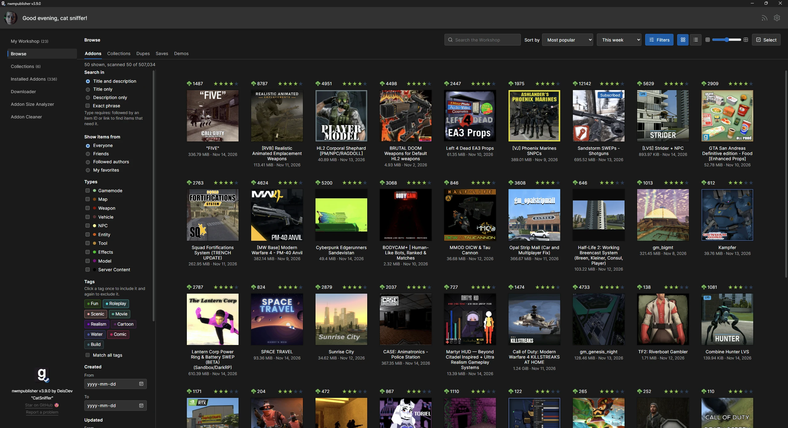
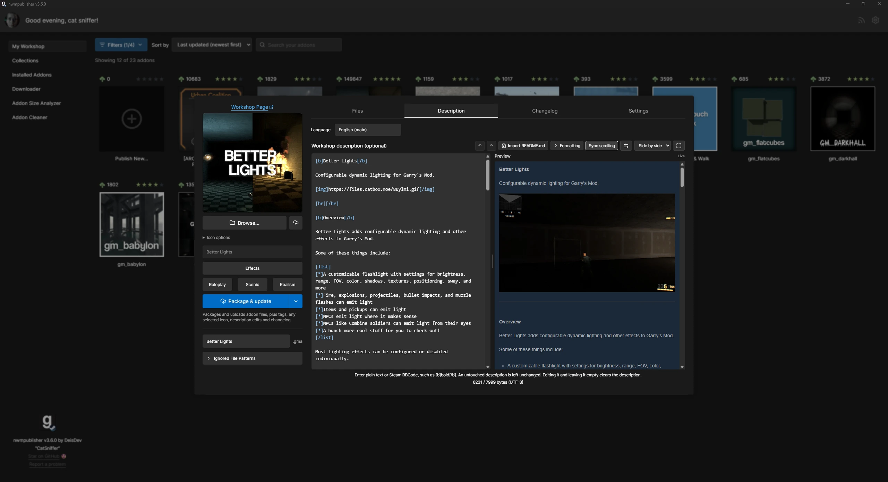
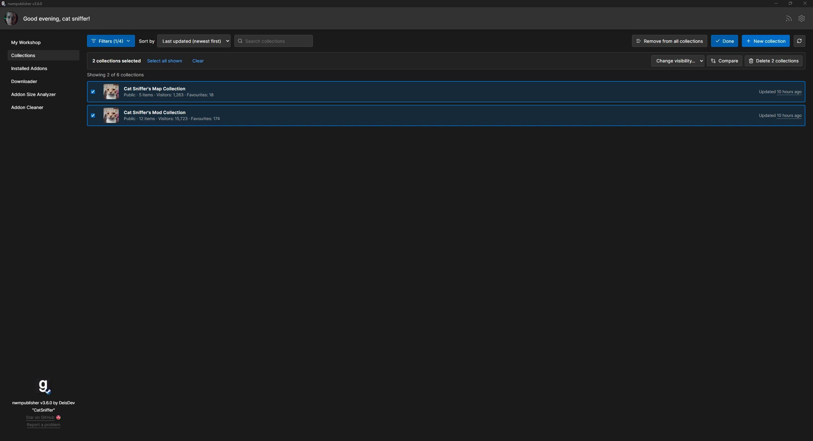
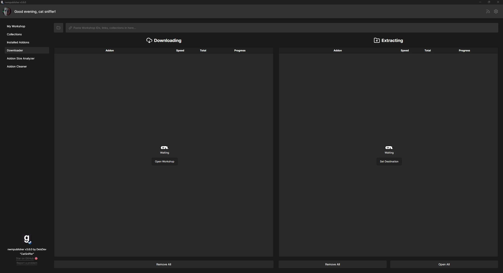
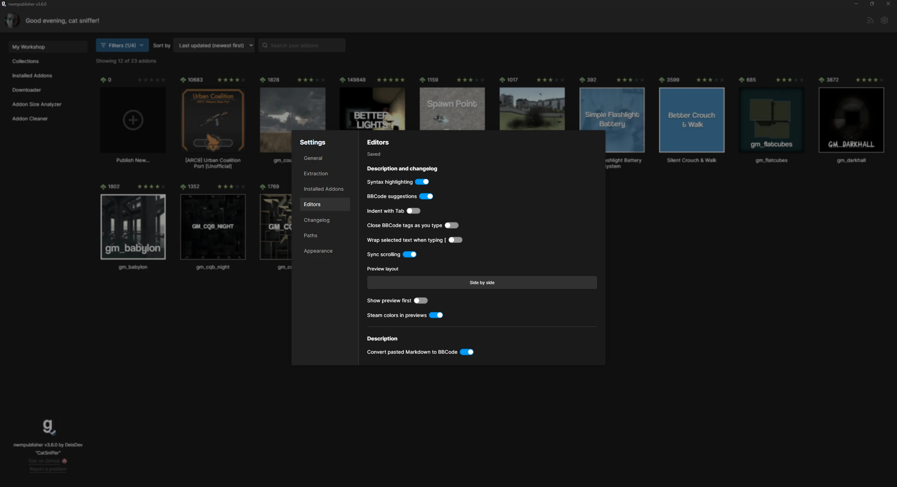

<p align="center">
  
</p>

<h1 align="center">nwmpublisher</h1>

<p align="center">
  A free app for uploading your Garry's Mod addons to the Steam Workshop,<br>
  and for downloading and opening other people's addons. No command line needed.
</p>

<p align="center">
  <a href="https://github.com/DeisDev/nwmpublisher/releases/latest"></a>
  <a href="https://github.com/DeisDev/nwmpublisher/releases/tag/nightly"></a>
  <a href="https://github.com/DeisDev/nwmpublisher/releases"></a>
  <a href="https://github.com/DeisDev/nwmpublisher/stargazers"></a>
  <a href="https://github.com/DeisDev/nwmpublisher/issues"></a>
  <a href="LICENSE"></a>
</p>

<p align="center">
  <a href="https://github.com/DeisDev/nwmpublisher/releases/latest"><b>Download</b></a> ·
  <a href="https://nwmpublisher.deis.me/">Website</a> ·
  <a href="#installation">Install guide</a> ·
  <a href="CHANGELOG.md">Changelog</a>
</p>

<p align="center">
  
</p>

## How it works

Keep Steam open and signed in while you use it.

### Uploading your own addon

1. Click **Publish New** and choose your addon's folder.
2. Check the list of files that will go in. nwmpublisher tells you if Garry's Mod won't accept one.
3. Add a title, description and icon, then click **Publish**. Updating it later works the same way.

### Getting other people's addons

1. Search the Workshop in **Browse**, or paste Workshop links into the **Downloader**.
2. Subscribe to use an addon in game, or download it to keep its files.
3. Open any addon to see what's inside, and copy its models, sounds and code into a normal folder.

## Features

### Publishing

* Pick the addon's file name and icon yourself (GIFs work)
* Format descriptions and changelogs with Steam's formatting tags (BBCode), and see how they'll look on Steam as you type
* Save changelog templates, or import your addon's `README.md` or `CHANGELOG.md`
* Translate the title and description into other Steam languages
* Change visibility, required addons or the description without uploading the files again

### Workshop

* Search the whole Workshop, filter by tag, and subscribe to or download many items at once
* Make, edit and compare collections, and check them against your subscriptions
* See subscribers, favourites, views, comments and votes for your own addons

### Addons on your PC

* Open any installed addon or `.gma` file (the file type Garry's Mod uses for addons), preview its images, textures,
  sounds, videos and code, and extract it to a folder
* Download and extract Workshop items and whole collections
* Extract, unsubscribe or delete many installed addons at once
* See which addons take up the most disk space
* Find and delete files left behind by addons you've unsubscribed from

### Other

* Doesn't need Garry's Mod's gmad.exe or gmpublish.exe, and opens old `.gma` files
* Command line for packing, extracting and publishing
* Light and dark themes, Discord status and 12 languages

## Screenshots

<table>
  <tr>
    <td></td>
    <td></td>
  </tr>
  <tr>
    <td></td>
    <td></td>
  </tr>
</table>

<details>
<summary><b>More screenshots</b></summary>

<table>
  <tr>
    <td></td>
    <td></td>
  </tr>
  <tr>
    <td></td>
    <td></td>
  </tr>
  <tr>
    <td></td>
    <td></td>
  </tr>
  <tr>
    <td></td>
    <td></td>
  </tr>
  <tr>
    <td></td>
    <td></td>
  </tr>
  <tr>
    <td colspan="2"></td>
  </tr>
</table>

</details>

## Coming from gmpublisher?

nwmpublisher started as a copy of [gmpublisher](https://github.com/WilliamVenner/gmpublisher) and still does everything
it does. It installs next to gmpublisher, so you can keep both, and the first time it runs it can import your
gmpublisher settings.

| | gmpublisher | nwmpublisher |
| --- | --- | --- |
| Adds "Uploaded with gmpublisher" to new addons | Yes | No |
| Uploaded file name | Always `gmpublisher.gma` | You pick it |
| Default icon | gmpublisher logo | Your Steam avatar |
| Description and changelog | Changelog text box only | BBCode editor with preview |
| Search the whole Workshop | No | Yes |
| Edit and compare collections | No | Yes |
| Clean up old Workshop files | No | Yes |
| Command line | Extract only | Extract, pack, list, info, publish |

## Installation

Download the latest release from the [releases page](https://github.com/DeisDev/nwmpublisher/releases).
Keep Steam running and signed in when using Workshop features.

| Platform | Download | Install |
| --- | --- | --- |
| Windows 10/11 | `.msi` | Open the installer. |
| Windows, portable | `x64_portable.zip` | Extract the whole ZIP, then run `nwmpublisher.exe` from the extracted folder. |
| macOS 13.3+, Intel or Apple Silicon | Universal `.dmg` | Open the disk image, drag nwmpublisher into Applications, then launch it from there. |
| Ubuntu 22.04+ / Debian 12+ | `amd64.deb` | In your download folder, run `sudo apt install ./nwmpublisher_*.deb`. |
| Fedora | `x86_64.rpm` | In your download folder, run `sudo dnf install ./nwmpublisher-*.rpm`. |
| Arch Linux | [`PKGBUILD`](PKGBUILD) | Save it in an empty folder and run `makepkg -si` there. |
| Other Linux / Steam Deck | `amd64.AppImage` | In the file's properties, allow it to run as a program, then open it. On Steam Deck, use Desktop Mode. |

The portable Windows build shares settings with the installed app in `%APPDATA%\nwmpublisher`, but does not add
shortcuts or `.gma` file associations. It needs [Microsoft WebView2 Runtime](https://developer.microsoft.com/en-us/microsoft-edge/webview2/#download-section),
which most Windows PCs already have. Windows is the main development and testing platform.

<details>
<summary><b>Linux: blank or broken window?</b></summary>

* The AppImage uses your system's WebKitGTK when it is installed. Set `NWMPUBLISHER_BUNDLED_WEBKIT=1` to use the copy
  inside the AppImage instead. If the window stays blank, install the package for your distribution instead.
* If the window looks wrong on Wayland, start it with `GDK_BACKEND=x11`, for example `GDK_BACKEND=x11 nwmpublisher`.
* If the window is blank or parts of it do not draw, which mostly happens with the proprietary NVIDIA driver, start it
  with `WEBKIT_DISABLE_DMABUF_RENDERER=1`. If that does not help, use `WEBKIT_DISABLE_COMPOSITING_MODE=1` to turn off
  accelerated rendering.

</details>

### Upgrading from gmpublisher

On Windows, nwmpublisher installs separately and leaves gmpublisher installed, so you can use both.

On first launch, nwmpublisher finds your gmpublisher settings and offers to import them (destinations, local addon
paths and preferences), then restarts with them applied.

To move them yourself instead, copy `settings.json` from the old `gmpublisher` folder into the `nwmpublisher` folder
in your config directory (`%APPDATA%` on Windows, `~/.config` on Linux, `~/Library/Application Support` on macOS).

### Nightly builds

[Nightly builds](https://github.com/DeisDev/nwmpublisher/releases/tag/nightly) are built each night from the newest
changes, when there are any, and may have bugs. A nightly build is a separate app, nwmpublisher-nightly: it installs
alongside the stable app, keeps its own settings, and tells you when a newer nightly is out.

Nightly downloads are a Windows `.msi` or portable `.zip`, a universal macOS `.dmg`, and a Linux `.AppImage`.
Choose **Nightly** when you report a problem.

## Command line

Run `nwmpublisher` without arguments to launch the app. With arguments, it can extract, pack, list, inspect, and
publish addons:

```sh
nwmpublisher --help
nwmpublisher --version
nwmpublisher --extract "addon.gma"
nwmpublisher --extract "addon.gma" --out "extracted-addon" --no-open
nwmpublisher --extract "addon.gma" --out-parent "addons" --workshop-title --workshop-metadata
nwmpublisher --pack "my_addon" --out "my_addon.gma"
nwmpublisher --list "addon.gma"
nwmpublisher --info "addon.gma"
nwmpublisher --publish "my_addon" --icon "icon.jpg" --description-file "description.txt"
nwmpublisher --publish "my_addon" --update 123456789 --changes "Fixed a bug"
```

<details>
<summary><b>Full command line reference</b></summary>

### Extracting

`-e` and `-o` are aliases for `--extract` and `--out`. Output goes directly into
`--out`, creating the directory if needed and overwriting matching files. Without
`--out`, extraction uses an addon-named folder in the application's configured
temporary directory (by default, `nwmpublisher` inside the system temporary directory, or
inside `~/.cache` on Linux).
This default destination follows the application's overwrite/recycle setting.
`--out-parent PATH` creates the addon folder inside `PATH` instead. `--out` can't be
combined with `--out-parent` or `--workshop-title`.

Workshop options use Steam and are off unless you pass them:

* `--workshop-title` names the addon folder `Workshop Title [123456789]`.
* `--workshop-metadata` saves the title, link, owner, and BBCode description to `workshop.txt`.
  If that name is taken, it uses `workshop (2).txt` and so on. `--metadata-name NAME` picks
  another `.txt` name.
* `--workshop-id ID` sets the Workshop item instead of reading the ID from the file name.

If Workshop details are unavailable, extraction still succeeds and warnings go to standard error.

Successful extraction prints the output path. The folder opens according to the
application's **Open folder after extraction** preference; `--no-open` always suppresses
opening it for that invocation. Use `--no-open` for scripts or environments without a desktop.
A folder-opening failure leaves the extracted files available.

### Packing and publishing

`--pack` and `--publish` read the title, type, tags, and ignore patterns from the folder's
`addon.json`, like gmad. `--title`, `--type`, and `--tags fun,build` override it. Files matching
your **Ignored File Patterns** setting are also skipped. `--pack` saves `FOLDER.gma` next to the
folder unless you pass `--out`.

`--publish` needs Steam running and signed in. Without `--update ID` it creates a new Workshop
item, which needs at least one tag and gets the default icon unless you pass `--icon`. With
`--update ID`, the Workshop title stays the same, and the description and icon change only if you
pass new ones. It prints the item's link when done. If Steam doesn't confirm the result, open
the app to review it before trying again.

`--list` prints each file's size in bytes and path. `--info` prints the title, type, tags, file
count, and size.

### Scripts

Exit codes are `0` for success (including help and version), `1` when the operation fails, and
`2` for invalid arguments. Results go to standard output; progress, warnings, and failures go to
standard error.

In Windows PowerShell scripts, wait for the GUI-subsystem executable and read its exit code:

```powershell
$cliProcess = Start-Process -FilePath .\nwmpublisher.exe -ArgumentList '--extract "addon.gma" --out "extracted-addon" --no-open' -NoNewWindow -Wait -PassThru
$cliProcess.ExitCode
```

</details>

## Languages

English, Chinese, Dutch, French, German, Korean, Polish, Portuguese (Brazil), Russian, Spanish, Turkish and Ukrainian.
[Want to translate nwmpublisher into your language?](i18n)

## Credits

Maintained by [DeisDev](https://github.com/DeisDev) ("CatSniffer"). Built on the work of
[William Venner](https://github.com/WilliamVenner) and the
[gmpublisher contributors](https://github.com/WilliamVenner/gmpublisher/graphs/contributors).
Licensed under the [GPL-3.0](LICENSE).
